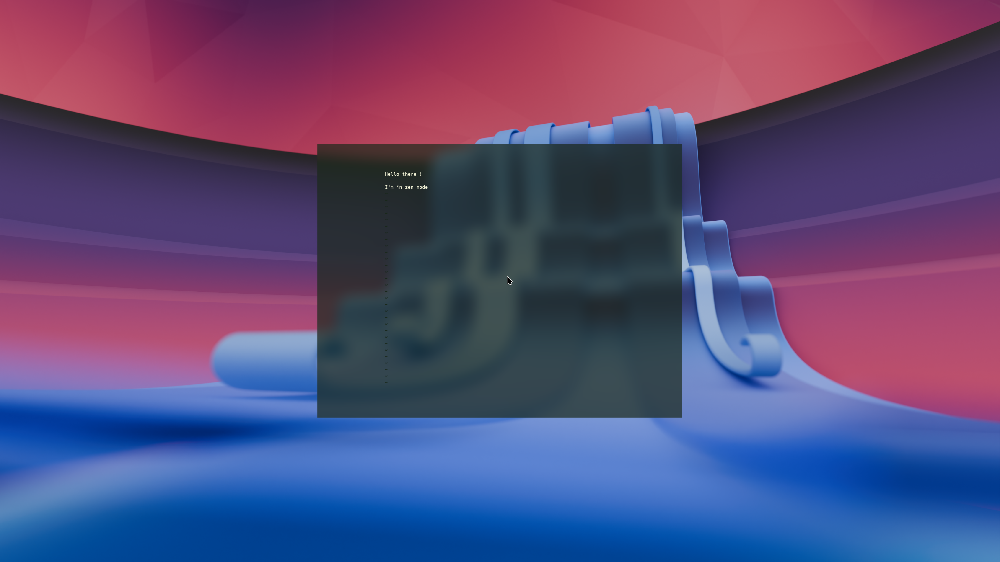

# Krohnkite

This fork adds features to [Krohnkite](https://codeberg.org/anametologin/Krohnkite),
the dynamic tiling script for KWin.

## What changed

### Zen desktop

`Meta+U` switches between your current desktop and a dedicated Zen desktop.
Panels are hidden in Zen while the wallpaper stays visible.

`Meta+Shift+U` sends the focused window to Zen, centered at a compact size
without borders. Use `Meta+U` to go back and forth, or press `Meta+Shift+U` on
the Zen window to return it to its original desktop and layout.

### Toggle the current split

In Tile mode, `Meta+E` switches the split around the focused window between
side-by-side and top-to-bottom. Other splits stay in place; pressing it again
restores the previous orientation and proportions.

### Choose the next split

In Tile mode, `Meta+B` places the next tiled window below the selected window;
`Meta+V` places it to the right. Existing windows stay in place until the new
window opens.

### Independent package

Installed as **Krohnkite (flowrange)** with the plugin ID `krohnkite-flowrange`,
so upstream updates do not overwrite the fork.

## Credits

Based on the work of **Eon S. Jeon**, **anametologin** and the Krohnkite
contributors. Additions by **flowrange**, with assistance from **Codex (OpenAI)**.
Licensed under the [MIT license](LICENSE).
